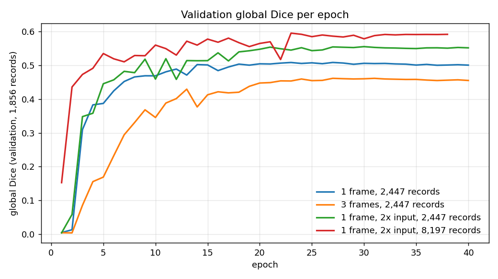
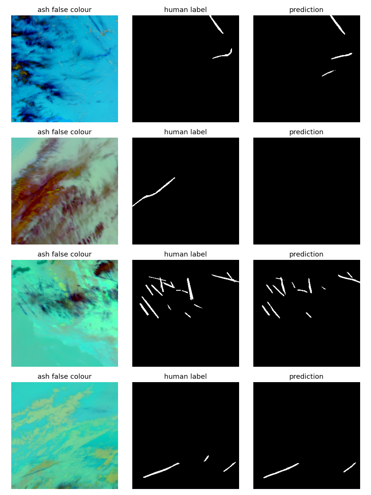

[English ] | [[Español](README.es.md) ]

# Contrail detection on GOES-16 satellite imagery


Pixel-level segmentation of aircraft condensation trails (contrails) in GOES-16 infrared
imagery, built for the Kaggle competition
[Google Research - Identify Contrails to Reduce Global Warming](https://www.kaggle.com/competitions/google-research-identify-contrails-reduce-global-warming).

Persistent contrails trap outgoing heat at night and account for roughly 1% of human-caused
warming. Airlines can avoid many of them by changing altitude slightly, but the physical models
that predict where contrails form need to be checked against what satellites actually see. This
project builds that check: a model that marks every contrail pixel in a 256x256 scene.

**Kaggle late submission:** public **0.568** / private **0.597** global Dice. The private score lands within 0.002 of the 0.595 validation score, so the validation estimate held up.

## Results

All runs are scored with the competition metric (global Dice: intersection and sizes pooled over
every pixel of the set) on the full validation split (1,856 records), 40 epochs each.

| Model | Train records | Global Dice |
|---|---|---|
| U-Net ResNet34, labelled frame | 2,447 | 0.508 |
| + two neighbouring frames as extra channels | 2,447 | 0.461 |
| + input upsampled 2x inside the network | 2,447 | 0.555 |
| + input upsampled 2x, more data | 8,197 | **0.595** |



What the numbers say:

- **Resolution matters more than anything else tried.** Contrails are often 1-3 pixels wide at
  2 km per pixel. Upsampling the input 2x before the encoder keeps them alive through the first
  stride-2 layers; the logits are pooled back to 256 px so loss and metric stay on the label grid.
  Same data, same epochs: +0.047 Dice.
- **More data still pays.** Going from 12% to 40% of the training set added another +0.040,
  and the curve was still rising.
- **Stacking time frames as channels hurt** (-0.047). Neighbouring frames are 10 minutes apart and
  contrails drift, so stacked frames are misaligned; the strong competition solutions used
  dedicated temporal modules instead.
- **The best threshold is far below 0.5** (0.1 for the final model, 0.005-0.02 for the others). With
  under 1% positive pixels the network's probabilities are poorly calibrated, so the cut-off is
  tuned on validation. A linear grid starting at 0.05 initially hid this; the grid is now
  log-spaced at the low end.
- **Long training overfits.** A 100-epoch run peaked at epoch 31 (0.509) and drifted down to 0.476
  while training loss kept falling.

The validation score selects both the checkpoint and the threshold, so it is mildly optimistic.
The Kaggle private score above is the independent number, and it agrees (0.597).

The submission runs offline on CPU on Kaggle ([`kaggle/submit.py`](kaggle/submit.py)). Two earlier GPU submissions failed during Kaggle's hidden-test rerun with a platform-side "system error" even though the notebook itself completed; the identical notebook on CPU scored normally.



The model catches straight, sharp contrails well. The second row is a miss: a contrail over a
complex cloud deck goes undetected entirely. Short fragments in the third row are also dropped.

## Data

- **OpenContrails** (Ng et al., 2023, [arXiv:2304.02122](https://arxiv.org/abs/2304.02122)),
  the source dataset of the competition, published by Google under **CC BY 4.0** at
  `gs://goes_contrails_dataset`. Used for 8,197 training records (shards 0-39 of 100) and the
  1,856-record validation split. Downloaded October 2026.
- **Kaggle competition data** (competition rules; not redistributed): metadata, the hidden test
  set at submission time, and a cross-check that OpenContrails record ids match Kaggle's.

Each record holds 8 frames, 10 minutes apart, of nine infrared bands at 256x256; the fifth
frame is labelled. Ground truth is the majority vote of 4+ human labellers.

### Getting the data without downloading 451 GB

The Kaggle archive is 451 GB and asking the API for each of ~90,000 files triggers its rate
limit (HTTP 429, account blocked for hours). Two loaders avoid that:

- [`remote_zip.py`](src/contrails/remote_zip.py) asks Kaggle once for the archive's signed storage
  URL, reads the zip central directory with HTTP Range requests, then fetches only the members
  needed (bands 11, 14, 15 and the mask), one range request per file.
- [`opencontrails.py`](src/contrails/opencontrails.py) streams OpenContrails TFRecord shards from
  the public bucket and decodes the serialized `TensorProto` blobs with a 40-line protobuf reader,
  so TensorFlow is not a dependency. Training records whose id belongs to the validation split are
  skipped.

Both write each record as the ash false-colour composite (bands 15-14, 14-11, 14) in `uint8`,
8 frames plus mask, ~1.2 MB instead of ~43 MB.

## Method

```
GOES-16 bands 11/14/15 (8 frames) ──► ash RGB uint8 ──► labelled frame (3 ch)
        │                                                   │
        │                                     bilinear upsample x2 (512 px)
        │                                                   │
        │                                  U-Net, ResNet34 encoder (ImageNet init)
        │                                                   │
        │                                   logits pooled back to 256 px
        │                                                   │
human masks (>50% of labellers) ─────────► BCE + soft Dice loss, AdamW, OneCycle
                                                            │
                                  threshold tuned on validation global Dice
                                                            │
                                     run-length encoding ──► submission.csv
```

Mixed precision on an RTX 4060 Ti (8 GB): ~0.5 min per epoch at 2,447 records and 256 px,
~2.7 min at 8,197 records and 512 px.

## Reproduce

```powershell
python -m venv venv
.\venv\Scripts\python.exe -m pip install torch torchvision --index-url https://download.pytorch.org/whl/cu124
.\venv\Scripts\python.exe -m pip install -r requirements.txt
$env:PYTHONPATH = "src"

# Kaggle metadata (needs ~/.kaggle/kaggle.json and accepted competition rules)
kaggle competitions download google-research-identify-contrails-reduce-global-warming -f validation_metadata.json -p data/raw

# data: ~300 GB streamed, ~10 GB kept
python -m contrails.opencontrails --split validation --shards (0..99)
python -m contrails.opencontrails --split train --shards (0..39)

# experiments
python -m contrails.train --name r34_f1_e40 --frames 1 --epochs 40 --train-list splits/train_2447.txt
python -m contrails.train --name r34_f3 --frames 3 --epochs 40 --train-list splits/train_2447.txt
python -m contrails.train --name r34_f1_up2 --upscale 2 --batch 8 --lr 3e-4 --epochs 40 --train-list splits/train_2447.txt
python -m contrails.train --name r34_f1_up2_full --upscale 2 --batch 8 --lr 3e-4 --epochs 40
python -m contrails.evaluate --name r34_f1_up2_full
python -m contrails.figures

pytest -q tests
```

The final run stopped after epoch 38 of 40 when the machine session ended; its best checkpoint
(epoch 23) is the one evaluated and submitted. [`kaggle/submit.py`](kaggle/submit.py) is the
offline inference script run on Kaggle.

## Layout

```
src/contrails/
  data.py           ash colour, Kaggle loader over the remote archive
  remote_zip.py     HTTP Range reader for zip members
  opencontrails.py  TFRecord / TensorProto streaming from GCS
  dataset.py        PyTorch dataset over compact records
  train.py          model, loss, training loop
  evaluate.py       global Dice over a threshold grid
  metrics.py        global Dice accumulator
  rle.py            competition run-length encoding
  predict.py        submission writer
  figures.py        README figures
kaggle/submit.py    offline Kaggle inference
tests/              RLE, metric, remote zip, end-to-end prediction
```

## Limitations

- 40% of the training set was used; the learning curve had not flattened.
- One encoder, one seed. Differences of ~0.01 between runs are within noise.
- No test-time augmentation or ensembling. Flips are optional in the code but untested: the
  labels are reported to be offset by half a pixel from the images, which a flip would move.

## License

Code: MIT. OpenContrails data: CC BY 4.0, Google. Kaggle competition data is not redistributed.
